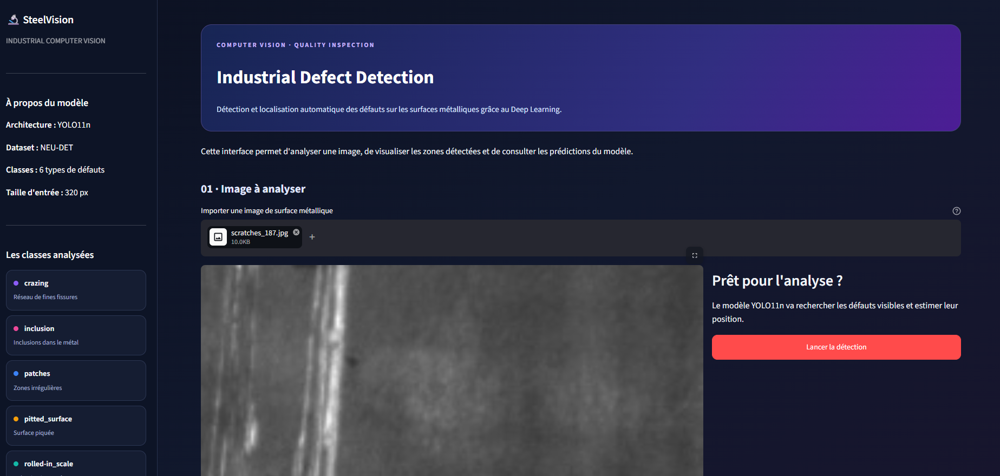
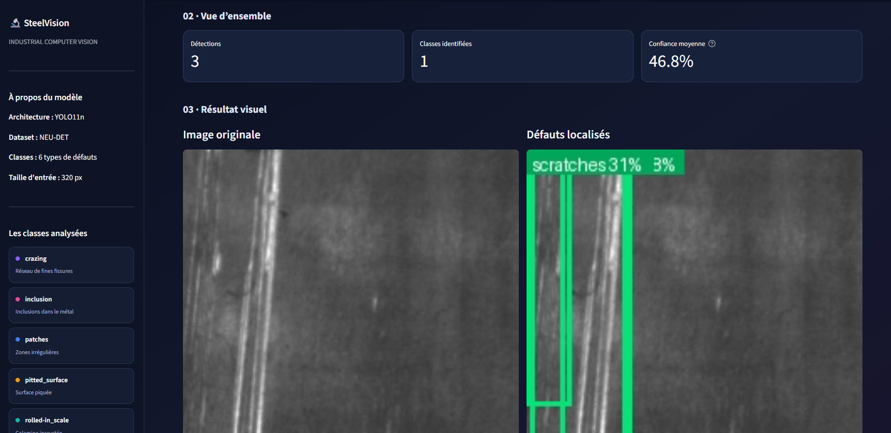

# SteelVision — Industrial Defect Detection

SteelVision est un projet de vision par ordinateur sur la détection de défauts présents sur des surfaces métalliques. L’objectif est d’utiliser le Deep Learning pour identifier les défauts dans une image et, avec un modèle de détection, localiser leur position.

J’ai travaillé sur le dataset NEU-DET, qui contient 1 800 images réparties en six catégories : crazing, inclusion, patches, pitted surface, rolled-in scale et scratches.

## Approche

J’ai commencé par explorer les images et les annotations afin de comprendre la répartition des classes et de préparer les données pour l’entraînement.

Pour la classification, j’ai utilisé ResNet18 avec du transfer learning. Le modèle a obtenu un F1-score de 0,9686 sur le jeu de test pour la classification multilabel.

J’ai ensuite travaillé sur la détection d’objets avec YOLO11n. Cette approche permet non seulement de reconnaître les défauts, mais aussi d'estimer leur emplacement dans l’image à l’aide de boîtes englobantes.

Sur le jeu de test, le modèle YOLO a obtenu un mAP@50 de 0,6907 et un mAP@50-95 de 0,3878. Les résultats restent variables selon les catégories, avec notamment des difficultés sur la détection de la classe *crazing*. Il reste donc du travail pour améliorer les performances.

## Démonstration

J’ai développé une API avec FastAPI pour envoyer une image et récupérer les prédictions du modèle. Une interface Streamlit permet ensuite de tester le système, de visualiser les défauts détectés et de consulter les résultats.

## Technologies utilisées

Python, PyTorch, Torchvision, YOLO11n, OpenCV, FastAPI, Streamlit, Pandas et Matplotlib.

## Organisation du projet

- `api/` : API de prédiction.
- `streamlit/` : interface de démonstration.
- `notebooks/` : exploration des données et entraînement des modèles.
- `src/` : code source.
- `tests/` : tests du projet.
- `data/` : données utilisées pour les expérimentations.
- `models/` : organisation des modèles.

Les données et les poids entraînés ne sont pas inclus automatiquement dans le dépôt GitHub.

## Lancer le projet

Installer les dépendances :

```bash
pip install -r requirements.txt
```

Démarrer l'API dans un terminal :

```bash
python -m uvicorn api.main:app --reload
```

Démarrer l'interface dans un autre terminal :

```bash
python -m streamlit run streamlit/app.py
```

L'API est accessible à l'adresse `http://127.0.0.1:8000` et sa documentation interactive à `http://127.0.0.1:8000/docs`.

Le lancement des prédictions nécessite également le modèle YOLO entraîné au chemin attendu par l'API.

## Limites

Les résultats obtenus sont expérimentaux. Certaines classes restent difficiles à détecter, et les performances doivent encore être améliorées avant d'envisager une utilisation dans un environnement industriel réel.S

## Aperçu

Voici un aperçu de l'interface développée pour tester le modèle et visualiser les défauts détectés.



### Résultat de détection


